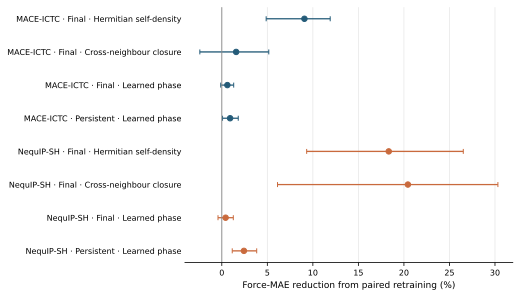
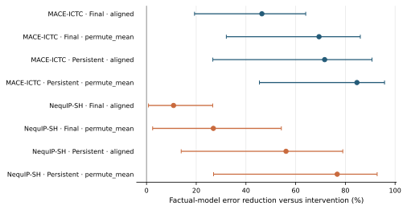
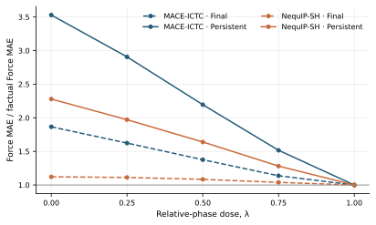
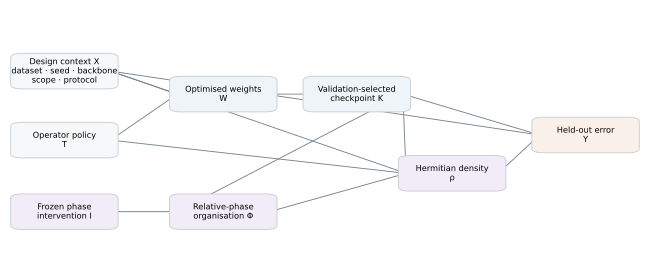

# Publication-grade DAG analysis of CHORUS

## Technical summary

The audited panel contains **240 independently trained models** and **80 fixed-model counterfactual probes** across four datasets and five paired seeds. The primary estimand is the macro-average change in held-out Force MAE, expressed on the log-error scale and weighted equally across datasets. Test atoms and frames remain nested outcomes; they are never counted as causal replicates.

The only component intervention that improves all 20 paired models in both backbones is the Hermitian self-density module. It lowers Force MAE by 9.07% [4.87, 11.90]% in MACE-ICTC and 18.33% [9.32, 26.52]% in NequIP-SH, with 20/20 seed-level wins in both backbones. Cross-neighbour closure is strongly backbone-dependent: 1.57% [-2.41, 5.16]% in MACE-ICTC and 20.44% [6.12, 30.32]% in NequIP-SH. Learned phase adds a smaller retraining benefit in Final models (0.61% [-0.12, 1.31]% and 0.42% [-0.42, 1.26]%); the Persistent point estimates rise to 0.91% [0.08, 1.81]% and 2.43% [1.15, 3.83]%.

Fixed-checkpoint interventions answer a different question: whether the fitted predictor actually uses its learned relative-phase organisation. Alignment and within-centre permutation raise error in both backbones, dose curves recover monotonically toward the factual model, and a common phase shift leaves predictions invariant within numerical tolerance. Together these results identify Hermitian density as the dominant end-to-end contribution and U(1)-structured relative phase as a functionally embedded organisation of the cross-neighbour terms.

## Primary retraining effects

| Backbone | Scope | Intervention | Force-MAE reduction | 95% hierarchical CI | Wins | BH q |
|---|---|---|---:|---:|---:|---:|
| MACE-ICTC | Final | diagonal vs off | 9.07% | [4.87, 11.90]% | 20/20 | 4.768e-06 |
| MACE-ICTC | Final | aligned vs diagonal | 1.57% | [-2.41, 5.16]% | 14/20 | 0.1792 |
| MACE-ICTC | Final | full vs aligned | 0.61% | [-0.12, 1.31]% | 16/20 | 0.08195 |
| MACE-ICTC | Final | full vs off | 11.05% | [5.78, 15.77]% | 20/20 | 4.768e-06 |
| MACE-ICTC | Persistent | full vs aligned | 0.91% | [0.08, 1.81]% | 11/20 | 0.04361 |
| NequIP-SH | Final | diagonal vs off | 18.33% | [9.32, 26.52]% | 20/20 | 4.768e-06 |
| NequIP-SH | Final | aligned vs diagonal | 20.44% | [6.12, 30.32]% | 17/20 | 0.0001221 |
| NequIP-SH | Final | full vs aligned | 0.42% | [-0.42, 1.26]% | 13/20 | 0.2083 |
| NequIP-SH | Final | full vs off | 35.30% | [18.49, 48.55]% | 20/20 | 4.768e-06 |
| NequIP-SH | Persistent | full vs aligned | 2.43% | [1.15, 3.83]% | 18/20 | 0.0002734 |

## Same-checkpoint phase interventions

| Backbone | Scope | Frozen intervention | Factual-model reduction | 95% hierarchical CI | Wins | BH q |
|---|---|---|---:|---:|---:|---:|
| MACE-ICTC | Final | aligned | 46.41% | [19.31, 64.05]% | 20/20 | 2.543e-06 |
| MACE-ICTC | Final | permute_mean | 69.40% | [32.11, 86.01]% | 20/20 | 2.543e-06 |
| MACE-ICTC | Persistent | aligned | 71.66% | [26.67, 90.72]% | 20/20 | 2.543e-06 |
| MACE-ICTC | Persistent | permute_mean | 84.66% | [45.42, 95.77]% | 20/20 | 2.543e-06 |
| NequIP-SH | Final | aligned | 10.87% | [0.78, 26.62]% | 15/20 | 0.0002117 |
| NequIP-SH | Final | permute_mean | 26.88% | [2.46, 54.24]% | 18/20 | 1.526e-05 |
| NequIP-SH | Persistent | aligned | 56.12% | [13.94, 78.96]% | 20/20 | 2.543e-06 |
| NequIP-SH | Persistent | permute_mean | 76.71% | [26.97, 92.79]% | 20/20 | 2.543e-06 |

## Propagation and backbone effect modification

| Interaction | Relative change in component benefit | 95% hierarchical CI | Wins |
|---|---:|---:|---:|
| NequIP-minus-MACE self-density transport contrast | 11.34% | [-0.81, 21.66]% | 15/20 |
| NequIP-minus-MACE cross-neighbour transport contrast | 23.71% | [5.55, 37.12]% | 17/20 |
| NequIP-minus-MACE complete-CHORUS transport contrast | 37.47% | [14.76, 64.21]% | 20/20 |
| MACE Persistent-minus-Final phase interaction | 0.30% | [-0.81, 1.43]% | 10/20 |
| NequIP Persistent-minus-Final phase interaction | 2.06% | [0.45, 3.84]% | 15/20 |
| NequIP-minus-MACE Final phase transport contrast | -0.19% | [-1.08, 0.81]% | 6/20 |
| NequIP-minus-MACE Persistent phase transport contrast | 1.56% | [-0.26, 3.61]% | 15/20 |
| MACE-ICTC Persistent-minus-Final frozen alignment interaction | 89.11% | [7.41, 319.93]% | 18/20 |
| NequIP-SH Persistent-minus-Final frozen alignment interaction | 103.12% | [14.22, 317.42]% | 19/20 |

## Key findings with visual evidence

## Scope, data, and metric definitions

- Datasets: xxMD malonaldehyde, MD22 Buckyball catcher, 3BPA at 300 K, and ZrO. These form a deliberately heterogeneous mechanism panel, not a random sample of chemical space.
- Seeds: 20260616–20260620, paired within every intervention cell.
- Primary outcome: test Force MAE from the checkpoint selected solely by complete-validation Force MAE.
- Secondary outcomes: Force RMSE and Energy MAE/RMSE from that same checkpoint. ZrO energy is used only with the declared train-only calibration in retraining comparisons; frozen ZrO energy is not used as a causal endpoint. The complete secondary table is exported, but its marked dataset heterogeneity does not support a backbone-wide Energy claim.
- Positive percentages denote error reduction for the treatment. Frozen percentages denote the factual model's error reduction relative to the destructive intervention.

## Causal graph and identification

The retraining estimand conditions by design on dataset, split, seed, optimisation budget, checkpoint rule, and precision protocol. Component policies are paired within dataset and seed. This identifies a controlled algorithmic intervention under the fixed benchmark protocol. Diagonal versus Off changes active module capacity and is therefore a total module effect. Full versus Aligned preserves the parameter schema and isolates learned relative phase under retraining.

The frozen branch holds the trained checkpoint and test inputs fixed while intervening on phase. It identifies fitted-model functional reliance, not a population-level molecular treatment effect. Backbone identity is not randomised, so NequIP–MACE differences are reported as transportability and effect modification rather than a causal effect of backbone choice.

The DAG organises these interventions and their identification assumptions; it is not a separately trained predictor. Effect estimates come directly from paired retraining and same-checkpoint counterfactual evaluation.

## Methodology

- Effects are paired log ratios, log(control error / treatment error), averaged over seeds within each dataset and then equally over datasets.
- Uncertainty uses 100,000 hierarchical bootstrap replicates, resampling datasets and then seeds.
- Exact sign-flip, Wilcoxon signed-rank, and binomial sign tests are reported as robustness checks. Benjamini–Hochberg q-values control the false-discovery rate within primary and secondary families.
- Dataset heterogeneity is assessed with leave-one-dataset-out estimates and a Hartung–Knapp random-effects sensitivity analysis. With only four datasets, heterogeneity parameters remain imprecise and are not promoted to primary evidence.
- The component ladder is a sequential intervention decomposition on the log-error scale. It is an exact telescoping comparison, not a mediation analysis of learned weights.

## Limitations, uncertainty, and robustness

The empirical causal target is algorithmic performance under the declared training protocol. It does not identify a universal effect over all molecules, architectures, or hyperparameters. Five seeds support paired optimisation comparisons but do not substitute for more datasets. Checkpoint selection is part of the treatment path and is held to one validation-only rule. The observational phase statistics remain post-hoc diagnostics; their weak correlations do not negate the frozen interventions because scalar phase summaries are lossy descriptions of a high-dimensional learned field.

All four macro dose curves are monotone: True. Cell-level monotonicity is reported separately in causal_analysis.json and is not inferred from the macro curve. The MACE observation rung reports a within-stratum rank correlation of -0.088 (permutation p=0.648), so no stable scalar phase–benefit association is claimed. The environment analysis contains 20 model pairs and retains atom/frame outcomes only as nested descriptive evidence.

## Paper-ready conclusion

Across two O(3)-equivariant backbones, the Hermitian second-order density is the most consistent source of CHORUS's gain. Cross-neighbour closure supplies an additional architecture-dependent benefit and is the largest incremental component in NequIP-SH, while learned U(1)-structured phase becomes more consequential when the charged state persists across depth. Frozen alignment, phase-dose, permutation, and common-shift controls show that this phase is used through relative interference and obeys the intended global U(1) invariance. The evidence supports a precise claim: CHORUS changes neighbour aggregation by introducing a stable Hermitian density interface, and persistent propagation turns its learned relative-phase organisation into a deeper computational state.

## Next steps

- Replicate the four-dataset causal panel on additional solids and reactive systems before making a chemistry-population claim.
- Pre-register the primary component contrasts for the next dataset tranche.
- Link frozen intervention sensitivity to long-time MD stability and dynamical observables without reusing those trajectories as independent causal replicates.

## Further questions

- Which local geometric motifs produce the largest conditional frozen-phase reliance?
- Does persistent phase reliance predict MD stability beyond held-out Force MAE?
- Can a low-rank CHORUS student reproduce a larger teacher's density response under distillation?
